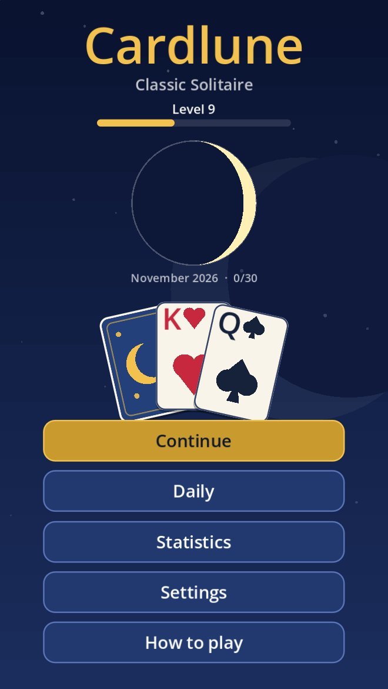
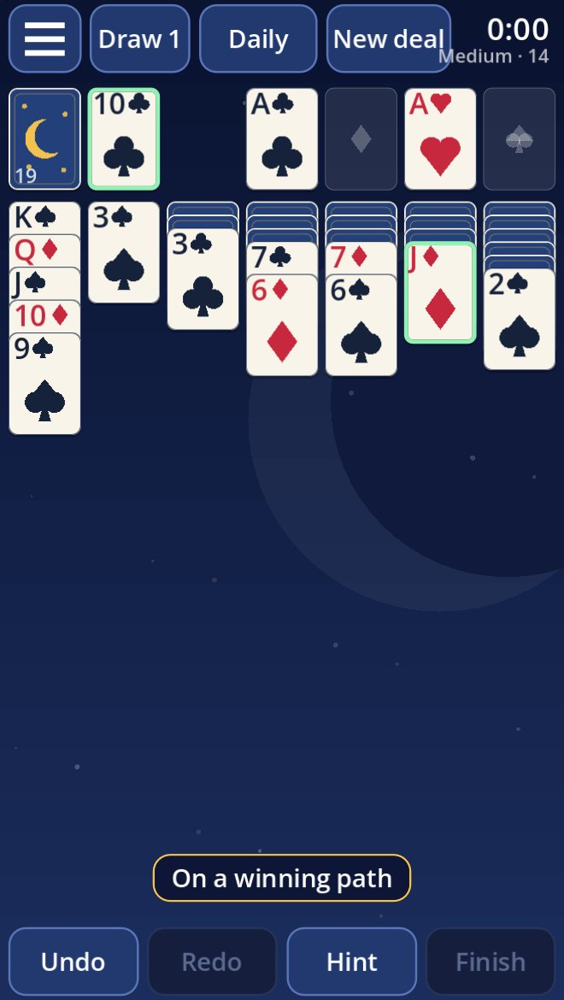
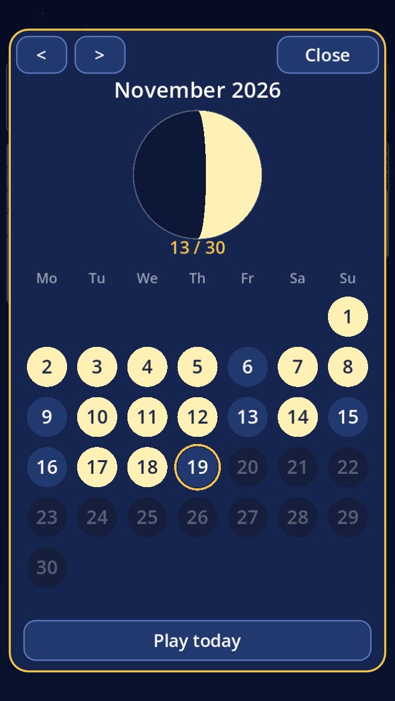
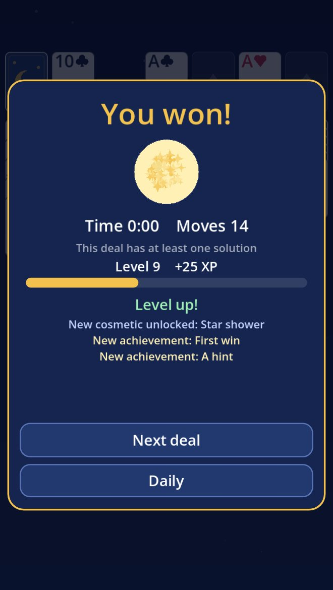

# Cardlune: Classic Solitaire

Classic Klondike solitaire for Android: calm, readable and offline. Every default deal is verified to have a solution, and a daily challenge fills one phase of the moon at a time.

[Türkçe](#türkçe) · [Privacy policy](privacy.md)

  
  
  
  

## Download

- **Android:** coming to Google Play.

## Features

- **Honest deals:** the default deals are checked by computer to have at least one solution. A solution existing does not mean you will always win; hard deals are really hard.
- **Daily challenge:** solve each day to fill the moon; solve every day of the month for a full moon. Easy deals early in the week, hard ones at the weekend.
- **Comfortable play:** draw 1 or draw 3, tap a card to send it where it goes or drag it, unlimited undo and redo, free hints, auto-finish.
- **"On a winning path" hint:** when the game knows a way to win from where you are, it shows the first step.
- **Left-hand mode, larger card text option, four-colour deck,** portrait and landscape, phone and tablet.
- **Easy on the eyes:** midnight-blue theme and crescent card backs; card backs, backgrounds and card faces unlock as you level up. 30 achievements and detailed statistics. Optional calm music.
- English and Turkish.

The game is free. It shows ads from Google AdMob, and they can be removed with a one-time purchase through Google Play.

## Support

passlune.app@gmail.com

Built with Godot Engine (MIT license). The icon, sound effects and music were generated in code for this game.

This repository holds the documentation only; the source code is not published here.

---

## Türkçe

# Cardlune: Klasik Pasyans

Android için klasik Klondike pasyans: sakin, okunaklı ve internetsiz. Varsayılan dağıtımların hepsinin çözümü olduğu doğrulanmıştır; günlük meydan okuma ayın bir evresini dolduruyor.

[Gizlilik politikası](privacy.md)

### Özellikler

- **Dürüst dağıtımlar:** varsayılan dağıtımların en az bir çözümü olduğu bilgisayarla doğrulanmıştır. Çözümün olması her zaman kazanacağın anlamına gelmez; zor eller gerçekten zordur.
- **Günlük meydan okuma:** her günü çözdükçe ay dolar; ayın her gününü çözersen dolunay olur. Hafta başı kolay, hafta sonu zor eller.
- **Rahat oynanış:** 1 ya da 3 kart çekme, karta dokun gideceği yere gitsin ya da sürükle, sınırsız geri al ve yinele, ücretsiz ipucu, otomatik bitir.
- **"Çözüm yolunda" ipucu:** oyun bulunduğun yerden kazanmanın yolunu biliyorsa ilk adımı gösterir.
- **Sol el modu, daha büyük kart yazısı seçeneği, 4 renkli deste,** dikey ve yatay, telefon ve tablet.
- **Göze hoş:** gece mavisi tema ve hilal desenli kart arkaları; seviye atladıkça kart arkaları, zeminler ve kart önleri açılır. 30 başarım ve ayrıntılı istatistik. İsteğe bağlı sakin müzik.
- Türkçe ve İngilizce.

Oyun ücretsizdir. Google AdMob reklamları gösterir; Google Play'den tek seferlik bir satın almayla kaldırılabilir.

### Destek

passlune.app@gmail.com
